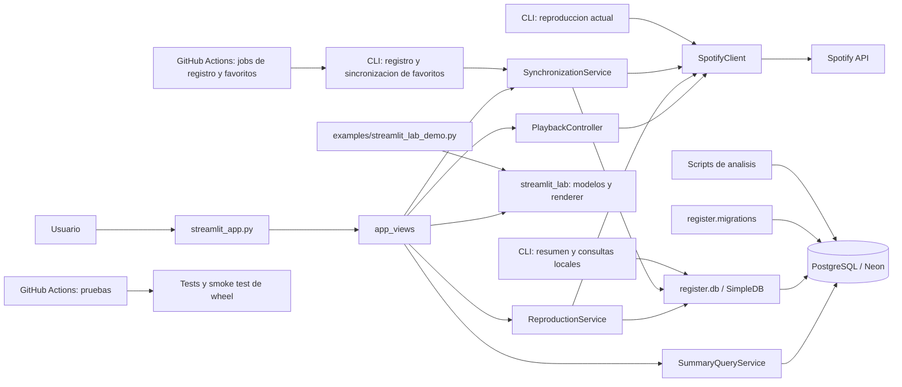

# Arquitectura

Documento canonico de la arquitectura implementada y de las propuestas aun no
integradas. La aplicacion es un monolito modular: Streamlit, CLI y GitHub Actions
comparten servicios y persistencia, sin un worker permanente.

## Estado actual

- `streamlit_app.py` carga secretos de Streamlit antes de enrutar a las vistas.
- `app_views` presenta resultados y coordina servicios; no contiene SQL de
  resumen. `SummaryQueryService` consulta PostgreSQL directamente mediante
  consultas parametrizadas.
- `PlaybackController` coordina estado, polling y snapshots con un cliente
  Spotify inyectado. `ReproductionService` coordina cambios de favoritos entre
  Spotify y la replica local.
- `SynchronizationService` comparte registro y reconciliacion de favoritos
  entre Streamlit, CLI y los jobs de Actions. `SimpleDB` gestiona conexiones y
  transacciones; las migraciones solo se ejecutan de forma explicita.
- Los scripts de analisis consultan PostgreSQL sin requerir credenciales de
  Spotify. Los graficos se escriben en `outputs/chart/`.
- `streamlit_lab` contiene modelos, controles y renderizado reutilizables. La
  demo independiente esta en `examples/`; las pruebas viven en `tests/`.
- La configuracion Neon se valida al abrir una conexion. Las credenciales de
  Spotify se validan al crear el cliente, no al importar los modulos.
- `pyproject.toml` publica los modulos, paquetes, entrypoints y el extra `ui`;
  `requirements.txt` instala el proyecto con la interfaz incluida.

## Propuestas

- Enriquecimiento opcional mediante adaptadores Last.fm, MusicBrainz y, solo si
    sigue disponible, AcousticBrainz. Los scripts existentes aun no forman un
    servicio de enriquecimiento integrado.
- Motor de recomendaciones explicables, tras acordar un caso de uso y un
    criterio de utilidad verificable.
- Optimizaciones de consultas, conexiones o cache solo despues de medir un
    cuello de botella.
