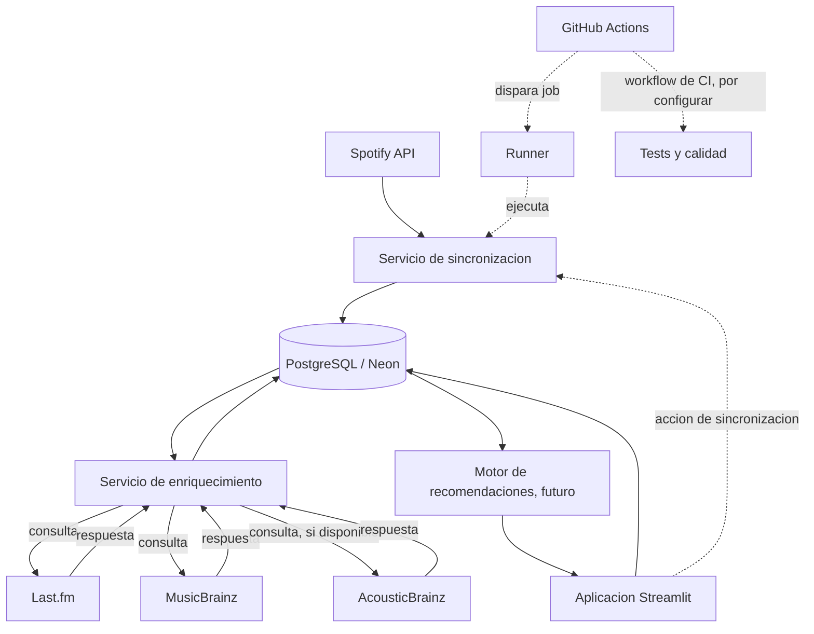

# Arquitectura propuesta

Este diagrama describe una arquitectura objetivo, no el estado completo actual
del sistema. El motor de recomendaciones y el workflow de tests y calidad están
pendientes de implementación. La sincronización puede iniciarse desde Streamlit
o ejecutarse desde un job de GitHub Actions.

