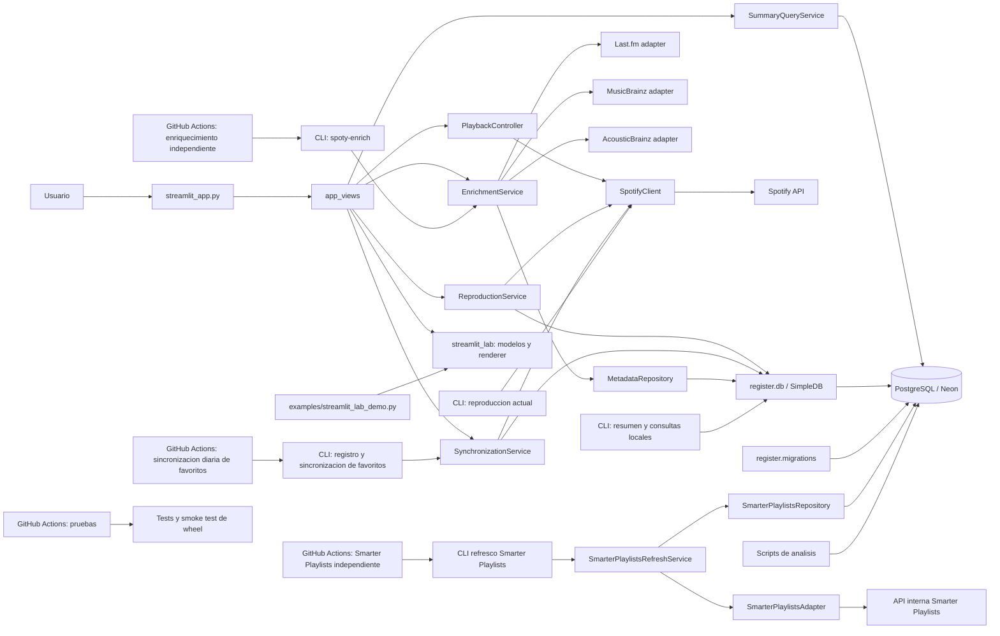

# Arquitectura

Documento canonico de la arquitectura implementada y de las propuestas aun no
integradas. La aplicacion es un monolito modular: Streamlit, CLI y GitHub Actions
comparten servicios y persistencia, sin un worker permanente.

## Estado actual

- `streamlit_app.py` carga secretos de Streamlit antes de enrutar a las vistas.
- `app_views` presenta resultados y coordina servicios; no contiene SQL de
  resumen. `SummaryQueryService` consulta PostgreSQL directamente mediante
  consultas parametrizadas.
- `PlaybackController` coordina estado, polling y snapshots con un cliente
  Spotify inyectado. `ReproductionService` coordina cambios de favoritos entre
  Spotify y la replica local.
- `SynchronizationService` comparte registro y reconciliacion de favoritos
  entre Streamlit, CLI y los jobs de Actions. `SimpleDB` gestiona conexiones y
  transacciones; las migraciones solo se ejecutan de forma explicita.
- `EnrichmentService` lee tracks pendientes mediante `MetadataRepository`, cierra
  la conexion antes de consultar proveedores y guarda cada fuente en tablas
  independientes. Normaliza tags e imagenes de Last.fm, generos y fechas de
  MusicBrainz, y los analisis `low-level` y `high-level` de AcousticBrainz.
  MusicBrainz solo se vincula ante una coincidencia unica y verificable;
  `raw_response` se conserva temporalmente durante la validacion.
- `_smarterplaylists.py` valida capturas offline mediante
  `services.smarterplaylists`. La escritura requiere `--apply` y usa
  `SmarterPlaylistsRepository` en una transaccion corta, sin llamadas HTTP.
  Cada captura tiene una huella idempotente; se verifican IDs locales antes de
  insertar. Los campos normalizados conservan procedencia y fecha individual,
  incluso al combinar capturas parciales o antiguas. Los datos de artista/album
  incluidos en una cancion quedan en `related_artist`/`related_album`, sin
  actualizar otras entidades. Las cuatro tablas de `0003_smarterplaylists_metadata`
  y sus tres vistas son optativas para consumidores; no cambian los servicios
  de reproduccion, sincronizacion o enriquecimiento actuales.
- `SmarterPlaylistsRefreshService` selecciona entidades nuevas/caducadas por
  lotes y consulta el adaptador sin conexiones DB abiertas.
  `0004_smarterplaylists_refresh_state` permite reintentos incluso sin metadata
  valida previa. El adaptador solo modifica programas marcados como propios,
  usa `save=false` y rechaza redirecciones, sesiones denegadas e IDs inesperados.
  La cookie procede de un secreto o archivo privado, no del OAuth de Spotify.
- Los scripts de analisis consultan PostgreSQL sin requerir credenciales de
  Spotify. Los graficos se escriben en `outputs/chart/`.
- `streamlit_lab` contiene modelos, controles y renderizado reutilizables. La
  demo independiente esta en `examples/`; las pruebas viven en `tests/`.
- La configuracion Neon se valida al abrir una conexion. Las credenciales de
  Spotify se validan al crear el cliente, no al importar los modulos.
- `pyproject.toml` publica los modulos, paquetes, entrypoints y el extra `ui`;
  `requirements.txt` instala el proyecto con la interfaz incluida.
- Los workflows diarios son independientes: favoritos 04:00 UTC, proveedores
  existentes 04:20 UTC y Smarter Playlists 04:40 UTC. No hay `needs` entre ellos;
  horarios, concurrencia, timeouts y disparadores manuales son independientes.
  Deben publicarse en la rama por defecto y configurarse sus secretos para que
  se ejecuten remotamente. Summary mantiene su disparador por lote.

## Propuestas

- Renovar operativamente la sesion de Smarter Playlists cuando caduque. El
  refresco diario esta implementado pero depende de sesion autorizada, secretos
  remotos y publicacion de workflows. No se automatiza el login.
- Definir retencion de respuestas originales tras medir el crecimiento. Las
  migraciones y el refresco se validaron con SQL real y lotes en Neon; el
  backfill completo y la publicacion remota son operaciones separadas.
- Retirar las columnas `raw_response` de las tablas de enriquecimiento cuando
  la normalizacion este validada.
- Motor de recomendaciones explicables, tras acordar un caso de uso y un
    criterio de utilidad verificable.
- Optimizaciones de consultas, conexiones o cache solo despues de medir un
    cuello de botella.
