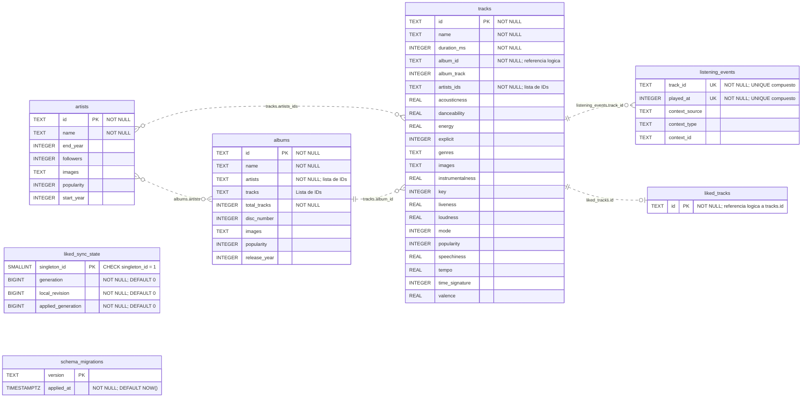

# Esquema de la base de datos

Diagrama del esquema PostgreSQL definido en [register/migrations.py](register/migrations.py).
Para verlo graficamente, abre la vista previa Markdown con soporte Mermaid
en VS Code, o consulta este archivo en GitHub.

## Diagrama entidad-relacion

Las lineas discontinuas representan relaciones logicas usadas por la aplicacion:
**no hay restricciones FOREIGN KEY en las migraciones actuales**. Las
cardinalidades muestran el modelo esperado, no garantias de integridad de la base.
Las tablas de control aparecen sin relaciones porque no referencian entidades.

## Restricciones y almacenamiento

- `PK` indica clave primaria. Todas las claves primarias son implicitamente
  `NOT NULL`, aunque el SQL no lo indique expresamente.
- Los dos campos `UK` de `listening_events` forman una sola restriccion
  `UNIQUE(track_id, played_at)`: ninguno es unico por separado. Esta tabla no
  tiene clave primaria.
- Los campos sin `NOT NULL` ni `PK` permiten `NULL`.
- `albums.artists`, `albums.tracks` y `tracks.artists_ids` almacenan listas
  serializadas en columnas `TEXT`, no tablas intermedias ni arrays PostgreSQL.
  `albums.tracks` complementa la relacion logica de `tracks.album_id`; no es
  una restriccion adicional ni garantiza una lista completa.
- `images` y `genres` tambien usan `TEXT`; `explicit` usa `INTEGER`, no `BOOLEAN`.
- `liked_tracks` guarda la pertenencia actual a favoritos; no contiene una
  fecha de incorporacion.
- `liked_sync_state` admite como maximo una fila, con `singleton_id = 1`.
  Sus contadores coordinan la sincronizacion de favoritos y los cambios locales.
- `schema_migrations` registra las versiones aplicadas y su fecha. La crea
  el ejecutor de migraciones, ademas de las seis tablas de la migracion inicial.

Este documento refleja el esquema declarado en el repositorio, no una
inspeccion de una instancia remota. Al cambiar las migraciones, actualiza
tambien este diagrama.
