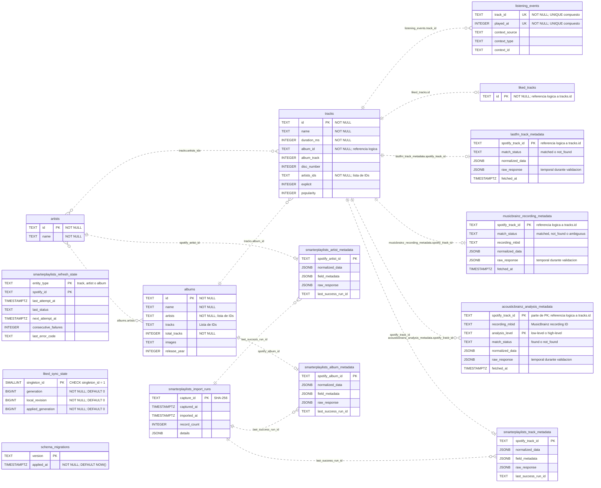

# Esquema de la base de datos

Diagrama del esquema PostgreSQL definido en [register/migrations.py](register/migrations.py).
Para verlo graficamente, abre la vista previa Markdown con soporte Mermaid
en VS Code, o consulta este archivo en GitHub.

## Diagrama entidad-relacion

Las lineas discontinuas representan relaciones logicas usadas por la aplicacion.
El catalogo y los proveedores no tienen restricciones FOREIGN KEY; la taxonomia
local si las utiliza. Las cardinalidades del catalogo muestran el modelo esperado,
no garantias de integridad de la base.
Las tablas de control aparecen sin relaciones porque no referencian entidades.

## Taxonomia local

La migracion `0007_genre_taxonomy` incorpora:

- `genres`: ID estable, nombre, procedencia de alta y fecha.
- `genre_relations`: clave compuesta padre/hijo, ambas con FK a `genres`,
  procedencia y prohibicion de autorrelaciones. Permite varios padres.
- `genre_label_mappings`: clave compuesta fuente/campo/etiqueta normalizada,
  FK opcional a `genres`, estado (`pending`, `approved`, `excluded`), procedencia
  y fecha. Solo `approved` exige un genero; los otros estados deben carecer de el.

Las etiquetas originales permanecen en los JSONB del proveedor. El importador
valida ciclos en el grafo combinado dentro de una transaccion serializada mediante
`pg_advisory_xact_lock(1936748392)`; las FK no impiden ciclos de varios nodos.
La semilla inicial no sobrescribe nombres, equivalencias aprobadas ni exclusiones.
No se crea ninguna copia de las escuchas ni se modifican las tablas de Spotify.

## Restricciones y almacenamiento

- `PK` indica clave primaria. Todas las claves primarias son implicitamente
  `NOT NULL`, aunque el SQL no lo indique expresamente.
- Los dos campos `UK` de `listening_events` forman una sola restriccion
  `UNIQUE(track_id, played_at)`: ninguno es unico por separado. Esta tabla no
  tiene clave primaria.
- Los campos sin `NOT NULL` ni `PK` permiten `NULL`.
- `albums.artists`, `albums.tracks` y `tracks.artists_ids` almacenan listas
  serializadas en columnas `TEXT`, no tablas intermedias ni arrays PostgreSQL.
  `albums.tracks` complementa la relacion logica de `tracks.album_id`; no es
  una restriccion adicional ni garantiza una lista completa.
- `albums.images` usa `TEXT`; las imagenes pertenecen al album, no a la pista.
  `explicit` usa `INTEGER`, no `BOOLEAN`.
- `tracks.disc_number` identifica el disco al que pertenece esa pista; se obtiene
  de la pista de Spotify y por eso no está en `albums`.
- La sincronizacion principal no guarda caracteristicas de audio ni metricas de
  perfil de artista: sus columnas estaban vacias y esos campos quedan en las
  tablas de metadata por proveedor. Los años del artista, popularidad de album,
  generos e imagenes de pista tampoco forman parte de estas entidades core.
- `liked_tracks` guarda la pertenencia actual a favoritos; no contiene una
  fecha de incorporacion.
- `liked_sync_state` admite como maximo una fila, con `singleton_id = 1`.
  Sus contadores coordinan la sincronizacion de favoritos y los cambios locales.
- Las tablas de metadata son independientes de `tracks` y entre proveedores. Su
  `spotify_track_id` es una relacion logica, no una FOREIGN KEY, siguiendo el
  esquema existente. `normalized_data` contiene la proyeccion propia de cada
  proveedor; `raw_response` conserva temporalmente la respuesta original para
  validar esa conversion y se retirara cuando termine esa etapa.
- MusicBrainz solo se vincula cuando titulo, artista y, si esta disponible,
  duracion identifican una unica grabacion. AcousticBrainz registra de forma
  independiente `low-level` y `high-level`; el servicio conserva la respuesta
  completa disponible de cada nivel en sus columnas JSONB.
- `schema_migrations` registra las versiones aplicadas y su fecha. La crea
  el ejecutor de migraciones, ademas de las seis tablas de la migracion inicial
  y las tres tablas de enriquecimiento de `0002_metadata_enrichment`.
  `0003_smarterplaylists_metadata` agrega cuatro tablas y tres vistas optativas.
  `0004_smarterplaylists_refresh_state` agrega el estado de actualizacion diaria.
  `0005_remove_non_spotify_core_columns` elimina campos vacios que no pertenecen
  al catalogo principal y actualiza la vista de detalles de album.
  `0006_prune_empty_catalog_columns` elimina las columnas vacias adicionales,
  mueve `disc_number` de `albums` a `tracks` y actualiza las vistas de metadata.

## Smarter Playlists

El diagrama resume estas tablas; sus columnas completas se declaran en
`register/migrations.py`. El importador y el refresco no sobrescriben las tablas
principales. Actions requiere publicar los workflows y configurar secretos.

Las tres tablas de metadata comparten, ademas de su PK:

- `normalized_data JSONB NOT NULL`: valores normalizados de la entidad. Las
  observaciones de artista/album en una cancion se guardan bajo `related_artist`
  y `related_album`, sin convertirse en registros independientes.
- `field_metadata JSONB NOT NULL`: procedencia por campo, incluida la ruta de
  campos anidados, fecha de captura, huella de importacion y origen declarado.
  `upstream_fetched_at` es nulo porque la antiguedad de la cache no se conoce.
- `raw_response JSONB`: ultima respuesta segun fecha de captura; permite NULL
  para una futura politica explicita de retencion. No hay borrado automatico.
- `missing_requested JSONB NOT NULL`: campos ausentes en esa respuesta, sin
  asumir que no existen o que los valores previos deban borrarse.
- `captured_at TIMESTAMPTZ NOT NULL`: fecha maxima de las capturas importadas.
- `last_attempt_status TEXT NOT NULL`: matched, partial, not_found, error o
  deferred. El importador actual solo escribe matched/partial; no interpreta
  un resultado vacio como not_found.
- `last_attempt_at` y `last_success_at TIMESTAMPTZ NOT NULL DEFAULT NOW()`:
  fecha del ultimo intento/importacion correcta en la base, no del proveedor.
- `next_attempt_at TIMESTAMPTZ` y `last_error_code TEXT`: espejo del estado de
  actualizacion diaria, mantenido por el servicio de refresco.
- `last_success_run_id TEXT NOT NULL`: huella de la captura mas reciente por
  fecha de origen, correspondiente a `raw_response`. Cada campo puede conservar
  la referencia a una captura anterior en `field_metadata`.

`smarterplaylists_import_runs` guarda solo importaciones correctas, una fila por
huella de captura. Las fallidas se revierten completas y se informan mediante la
CLI. El detalle incluye version de normalizacion y entidades importadas, sin
credenciales ni respuestas de autenticacion. Las relaciones siguen siendo
logicas, sin nuevas FOREIGN KEY. Cada tabla de metadata tiene un indice de
`next_attempt_at` para el futuro selector de candidatos.

`smarterplaylists_refresh_state` es la fuente operativa de reintentos, incluso
para IDs que todavia no tienen metadata valida. Su PK es `(entity_type,
spotify_id)` y guarda intento, estado, proximo intento, fallos consecutivos y
codigo de error sin secretos. Un error no crea una falsa captura correcta.
El selector consulta entidades locales, prioriza las nunca intentadas y respeta
caducidad y backoff. Tras exito se programa la siguiente actualizacion; tras
fallo, el backoff crece de 15 minutos a 24 horas. No cambia favoritos ni escuchas.

Vistas optativas:

- `smarterplaylists_track_features`: audio tipado desde metadata de Smarter
  Playlists, con procedencia por campo y popularidad del nucleo separada de la
  popularidad del recurso.
- `smarterplaylists_artist_details`: seguidores BIGINT y popularidad del recurso,
  junto a JSONB y procedencia; el catálogo principal ya no duplica esos campos.
- `smarterplaylists_album_details`: fecha TEXT (admite precision de ano/mes/dia),
  sello, total de pistas, popularidad del recurso y metadata JSONB.

No se unifican automaticamente los generos de Spotify, MusicBrainz, Last.fm ni
los analisis de AcousticBrainz. Los campos del recurso son observaciones del
proveedor, no una verificacion independiente. Los seguidores admiten BIGINT
al normalizar y al consultar; los restantes enteros expuestos en las vistas se
validan en el rango INTEGER. Las propiedades nuevas desconocidas se conservan
en la respuesta original, no se convierten automaticamente en campos fiables.

Este documento refleja el esquema declarado en el repositorio, no una
inspeccion de una instancia remota. Al cambiar las migraciones, actualiza
tambien este diagrama.
