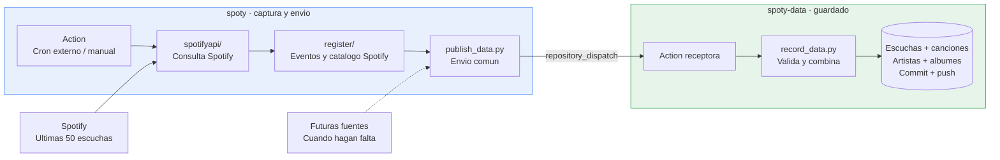

# Distribucion de la informacion

- **Credenciales:** `.env` local o Actions secrets en `spoty`; nunca en el CSV.
- **CSV:** `listening_events.csv`, `tracks.csv`, `artists.csv` y `albums.csv`.
- **Sin CSV intermedio:** solo `spoty-data` escribe datos.
- **`old/` en ambos repos:** legado, fuera del flujo nuevo.
