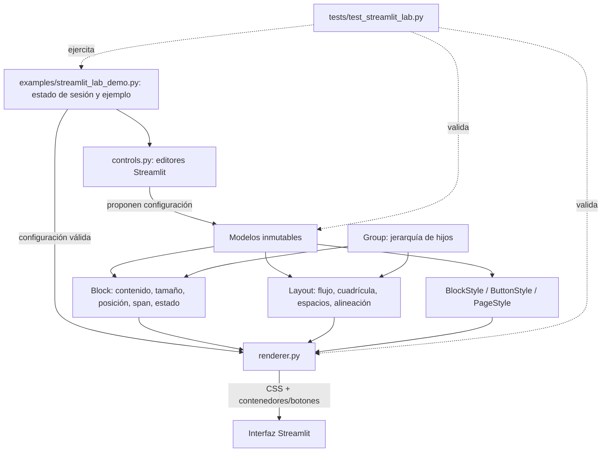

# Resumen del desarrollo actual de Streamlit Lab

## Propósito y estado

`streamlit_lab` es un conjunto de primitivas reutilizables para describir y
renderizar interfaces de Streamlit mediante configuración declarativa. La demo
independiente para probar layouts y apariencia vive en
`examples/streamlit_lab_demo.py`; sus módulos se reutilizan en la aplicación
principal, donde reproducción y navegación importan modelos y renderizadores.

El laboratorio se puede ejecutar desde la raiz sin Spotify ni base de datos con
`streamlit run examples/streamlit_lab_demo.py` (puerto 8502). La aplicación
principal lo importa como paquete `streamlit_lab`.

## Elementos y responsabilidades

| Módulo | Responsabilidad | Relación principal |
| --- | --- | --- |
| `blocks.py` | Modelos de bloque, medida, posición y extensión: `Block`, `Size`, `Position`, `Span`. | Un `Block` representa una unidad visual y contiene dimensiones, comportamiento y un `BlockStyle`. |
| `layout.py` | `Layout` calcula posiciones y valida cuadrículas; `Group` compone bloques y otros grupos. | Cada grupo tiene su propio layout; los layouts anidados son independientes. |
| `styles.py` | Modelos inmutables de apariencia y validadores: `BlockStyle`, `ButtonStyle`, `PageStyle`, `Border`, `Shadow`, `Insets`, `Corners`. | Los estilos son datos separados del renderizado; `BlockStyle` pertenece a bloques, `ButtonStyle` a botones y `PageStyle` a la página. |
| `controls.py` | Controles de Streamlit para editar layout, bloque, dimensiones y apariencia desde la barra lateral. | Devuelve nuevas configuraciones; no renderiza los bloques de contenido. |
| `renderer.py` | Convierte la configuración a CSS acotado por claves y crea contenedores/botones de Streamlit. | `render_group` resuelve grupos, llama a `render_layout` y `render_block`, y delega el contenido en una función. |
| `examples/streamlit_lab_demo.py` | Demo interactiva: estado de sesión, ejemplo inicial, selección de bloque, edición y exportación JSON. | Conecta los controles con los modelos y pasa el resultado a `render_group`. |
 | `tests/test_streamlit_lab.py` | Pruebas de modelos, validación, CSS y flujos de la demo. | Comprueba tanto reglas puras como interacciones mediante `streamlit.testing.AppTest`. |

## Relación entre los conceptos



Un `Group` establece estructura, no apariencia: contiene claves de bloques u
otros grupos y asigna un `Layout` propio. El orden de `children` define el
recorrido y `position`/`span` de un bloque se interpretan en el layout de su
grupo inmediato. Los bloques conservan sus dimensiones y estilo al cambiar de
grupo. `render_group` valida referencias, claves y ubicaciones antes de
renderizar; el contenido de cada bloque queda a cargo del callback de la
aplicación.

## Estandarización definida hasta ahora

- **Configuración declarativa e inmutable.** Los modelos son `dataclass`
  congeladas. Las modificaciones producen nuevos valores, normalmente con
  `dataclasses.replace`, en lugar de alterar objetos compartidos.
- **Claves estables y únicas.** Bloques y grupos usan claves con formato
  restringido; el renderizador las convierte en claves de contenedor y
  selectores CSS `st-key-*`. Se rechazan claves repetidas, referencias
  inexistentes, hijos duplicados, colisiones y ubicaciones fuera de la
  cuadrícula.
- **Unidades y límites explícitos.** `Size` admite `px`, `%`, `vw`, `vh` y
  `dvh`, límites mínimo/máximo y un desplazamiento en píxeles. Las alturas
  proporcionales usan unidades de viewport (`vh`/`dvh`), no `%`.
- **Separación de estructura y presentación.** `Layout` y `Group` organizan;
  `BlockStyle` define la apariencia del bloque. Los estilos de página y de
  botones tienen modelos propios. Un grupo no introduce estilos ni altera el
  estilo de sus hijos.
- **Validación antes de aceptar cambios.** Los modelos comprueban valores
  finitos, rangos, unidades, colores, alineaciones, proporciones, URLs HTTP(S) y
  consistencia entre propiedades. En la demo, si una edición provoca una
  configuración inválida, se muestra el error y se conserva la última válida.
- **Responsive sin desbordar el ancho disponible.** Los bloques limitan su
  ancho al contenedor; el mínimo no debe ensanchar la página. `Layout` permite
  breakpoint por ancho o colapso en orientación vertical, pesos de columnas y
  filas verticales, y los bloques pueden tener altura específica en portrait o
  esconderse en pantallas estrechas. Los layouts internos conservan su propia
  distribución al colapsar un grupo exterior.
- **Espaciado y alineación configurables por nivel.** Hay separación general,
  por filas/columnas y entre el layout y el contenido vertical padre; padding,
  alineación de layout, bloque y contenido, además del desbordamiento interno.
- **CSS acotado por clave.** El renderizador usa los contenedores con clave de
  Streamlit para limitar reglas a la página, layout, bloque o botón
  correspondiente, en vez de aplicar cada regla visual globalmente.
- **Compatibilidad controlada con Streamlit.** El renderizador se apoya en
  selectores internos como `st-key-*` y atributos `data-testid`. La dependencia
  está fijada en `requirements.txt` a Streamlit `1.63.0`, y la demo advierte que
  conviene comprobar el CSS al actualizar Streamlit.

## Qué ofrece la interfaz del laboratorio

La barra lateral permite restablecer el ejemplo, cambiar el layout raíz,
seleccionar un bloque y editar su comportamiento, color, dimensiones y
apariencia. En `Apariencia del bloque` se selecciona la variante `Normal`,
`Hover`, `Seleccionado` o `Deshabilitado`; las variantes opcionales se editan de
forma independiente y se pueden quitar para heredar el estilo normal. El estado
que se muestra se elige aparte en el comportamiento del bloque. El ejemplo usa
cinco bloques bajo dos grupos (`contenido` y
`lateral`) dentro de un grupo raíz: sirve para ver layouts anidados, spans y
distribución responsive. La configuración completa se muestra como JSON y se
puede descargar; los cambios viven en `st.session_state` durante la sesión.

La edición visual cubre `Layout`, `Block`, `Size`, el estilo normal y las
variantes `hover`, `selected` y `disabled` de `BlockStyle`. `ButtonStyle` y
`PageStyle` están disponibles como modelos/renderizadores para uso desde código,
pero no tienen paneles de edición en la demo actual. La exportación JSON es de
solo salida: todavía no existe importación/restauración de una configuración
exportada.

## Integración con la aplicación principal

- `app_views/reproduction.py` usa `Block`, `Group`, `Layout`, `BlockStyle`,
  `ButtonStyle`, `PageStyle`, `render_group`, `render_button` y
  `render_page_style`. La pantalla organiza las pistas anterior/actual/siguiente
  en grupos y aplica composición horizontal en escritorio y vertical en
  portrait.
- `app_views/top_navigation.py` también construye los botones de navegación
  como bloques dentro de un grupo y renderiza con `render_group`.
- Las llamadas de Spotify, el estado de reproducción y la lógica de página
  siguen perteneciendo a la aplicación principal; el laboratorio aporta la
  composición y el estilo, no la lógica de dominio.
- `app_views/interface_layout.py` conserva otra implementación de helpers de
  layout/estilo y tiene pruebas propias. La navegación y reproducción actuales
  importan `streamlit_lab`; por tanto, hay dos superficies de composición que
  conviene tener presentes al decidir futuras migraciones o limpieza.

## Pruebas y límites actuales

`tests/test_streamlit_lab.py` cubre reglas de tamaños, posiciones y spans, layouts anidados,
estilos, sanitización básica de URLs, CSS generado, controles de la demo y
conservación de la configuración válida ante errores. La suite usa
`unittest` y `AppTest`; puede ejecutarse desde esta carpeta con:

```powershell
.\venv\Scripts\python.exe -m unittest discover -s tests -p "test_streamlit_lab.py"
```

El CSS depende de detalles del DOM de Streamlit, así que las pruebas unitarias
no sustituyen la comprobación visual en navegador. Otras limitaciones visibles
hoy son que la importación JSON no está implementada, la demo guarda los
cambios solo durante la sesión y que `ButtonStyle`/`PageStyle` no se editan desde
la demo. La versión probada de Streamlit y los selectores internos hacen
especialmente importante la verificación visual tras una actualización de
dependencia.
